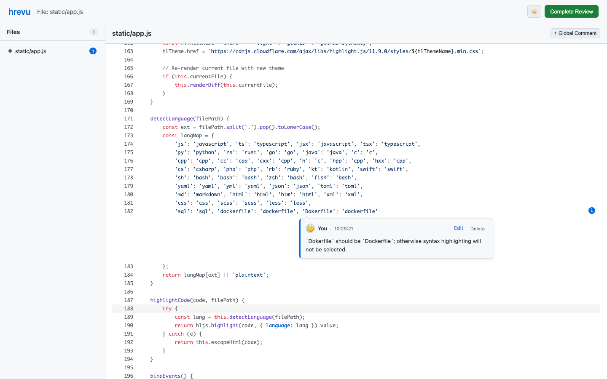

# /human-review for AI

[中文文档](README.zh-CN.md) | English

A CLI tool for manual code review with a web-based interface. Designed for AI coding workflows (Claude, Gemini, etc.), providing a browser-based review experience without cramped terminal input boxes.

## Quick Start

```bash
# Install CLI tool
cargo install human-review

# Install Claude Code skill
npx skills add alingse/human-review
```

## Usage

Use `/human-review` in your AI coding assistant:

```
/human-review diff              # Review current changes
/human-review README.md         # Review a specific file
/human-review abc1234           # Review a commit
/human-review last commit       # Review the last commit
/human-review current plan      # Review a plan document
```

Or use natural language - your AI will understand:
- `/human-review "Review the changes I just made"`
- `/human-review "Check the authentication module"`
- `/human-review "I want to review the last 3 commits"`

## Browser Review

Click an exact code position, add an inline comment, then select **Complete Review** to return the feedback to your AI assistant.



## Features

- **Browser-based review** - Light-first web interface with optional dark mode
- **Markdown review** - Rendered by default with tables, task lists, highlighted code and Mermaid diagrams; switch to source review without losing comments or drafts
- **Point comments** - Click rendered content for a compact input that expands when you type; side margins and dragging do not open comments. Feedback keeps its approximate source range and visual position
- **Line-and-column commenting** - Anchor precise feedback to the exact code position
- **Multiple input modes** - Review commits, diffs, or any file
- **AI workflow integration** - Structured review context for applying actionable feedback
- **Bilingual** - Auto-detects Chinese/English based on browser locale

## License

MIT

## Development checks

```bash
cargo test
node --test tests/markdown.test.cjs
cargo build
python3 tests/history_e2e.py
```

Markdown reviews use complete snapshots, including context outside diff hunks.
Source view retains added/removed rows; comments on removed text appear with the
previous version in rendered view. Every accepted comment change is saved before
it is acknowledged, together with the reviewed file snapshots.

## Saved reviews

```bash
hrevu README.md                         # Prints a review ID and saved JSON path
hrevu history --json                    # List reviews, including unfinished ones
hrevu show <review-id> --json            # Read comments at any time, without a server
hrevu history                           # Open history and download text/JSON
hrevu resume <review-id>                 # Continue an unfinished review
hrevu export <review-id> --format text --output review.txt
hrevu README.md --exit-on-complete       # Automation that needs process exit
```

The browser stays available after completion. Completed history is read-only and
renders the original snapshots even if source files change or are deleted. On
macOS/Linux, records default to `~/.local/share/hrevu/reviews/` (or the XDG data
directory); Windows uses local app data. Set `HREVU_DATA_DIR` to override the base
directory. `--no-open` serves without launching a browser.

For AI workflows, keep the printed review ID and read `hrevu show <id> --json`.
The saved `status`, rather than process exit, indicates completion. Use
`hrevu history --json` to recover a missing ID; records include the target,
working directory, timestamps, comments and their source snapshots.
