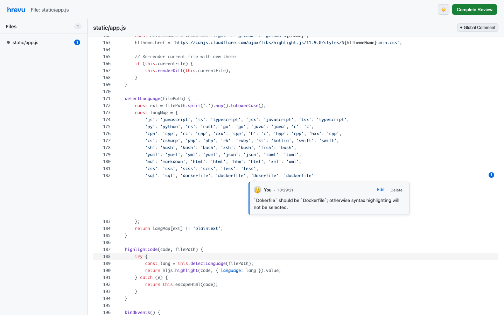

# /human-review for AI

中文文档 | [English](README.md)

一个基于 Web 界面的手动代码审查 CLI 工具。专为 AI 编码工作流（如 Claude、Gemini 等）设计，提供浏览器端的审查体验，告别狭窄的终端输入框。

## 快速开始

```bash
# 安装 CLI 工具
cargo install human-review

# 安装 Claude Code 技能
npx skills add alingse/human-review
```

## 使用方法

在 AI 编码助手中使用 `/human-review`：

```
/human-review diff              # 审查当前变更
/human-review README.md         # 审查指定文件
/human-review abc1234           # 审查某个提交
/human-review last commit       # 审查最后一次提交
/human-review current plan      # 审查计划文档
```

或使用自然语言 - AI 会理解您的意图：
- `/human-review "审查我刚做的更改"`
- `/human-review "检查一下认证模块"`
- `/human-review "我想审查最近 3 次提交"`

## 浏览器端审查

点击代码的具体位置添加内联评论，然后选择**完成审查**，即可将反馈返回给 AI 编码助手。



## 功能特性

- **浏览器端审查** - 默认浅色、可切换深色的完整 Web 界面
- **行列级评论** - 将精确反馈锚定到具体代码位置
- **多种输入模式** - 支持审查提交、差异或任意文件
- **AI 工作流集成** - 输出结构化审查上下文，供 AI 处理明确反馈
- **双语支持** - 根据浏览器语言自动切换中英文

## 许可证

MIT

## Markdown 审查

Markdown 默认显示渲染视图，支持表格、任务列表、代码高亮和 Mermaid。
点击正文或图表先显示小输入条，输入文字或点展开按钮后才展开完整卡片。
两侧空白不触发评论，拖动选中文字和滚动也不会误弹评论框。
右上角「渲染 / 源码」可切换为带增删行的源码审查，已保存的评论位置和未提交草稿都会保留。
源码视图包含完整文档，diff 片段以外的评论也能看到；旧内容的评论会显示在修改前版本中。

每次提交、编辑、删除评论以及完成审查，都会先自动落盘，再向页面确认。
保存内容包含审查 ID、状态、工作目录、文件快照、评论原文、源码范围和点位。

## 历史、恢复与导出

```bash
hrevu README.md                       # 启动时打印审查 ID 和保存路径
hrevu history --json                  # 列出历史，也包括未完成的审查
hrevu show <review-id> --json          # 随时获取已提交的中间数据，无需服务器
hrevu history                         # 打开历史网页，一键导出文字或 JSON
hrevu resume <review-id>               # 恢复未完成的审查
hrevu export <review-id> --format text --output review.txt
hrevu README.md --exit-on-complete     # 需要完成后退出进程的自动化场景
```

完成后页面默认保持可访问。历史记录只读，使用保存时的文件快照，源文件变化或删除也不影响查看。
macOS/Linux 默认保存在 `~/.local/share/hrevu/reviews/`，也支持 XDG 数据目录；Windows 使用本地应用数据目录。
可用 `HREVU_DATA_DIR` 指定基础目录，记录位于其 `reviews/` 下。`--no-open` 可只启动服务而不打开浏览器。

AI 应记住启动时的审查 ID，通过 `hrevu show <id> --json` 获取评论，并以保存记录中的 `status=completed`
判断用户已完成审查。进程退出或终端输出不再是唯一取数入口；忘记 ID 时可通过 `hrevu history --json` 查找。

开发检查：`cargo test`、`node --test tests/markdown.test.cjs`、`cargo build`、`python3 tests/history_e2e.py`。
